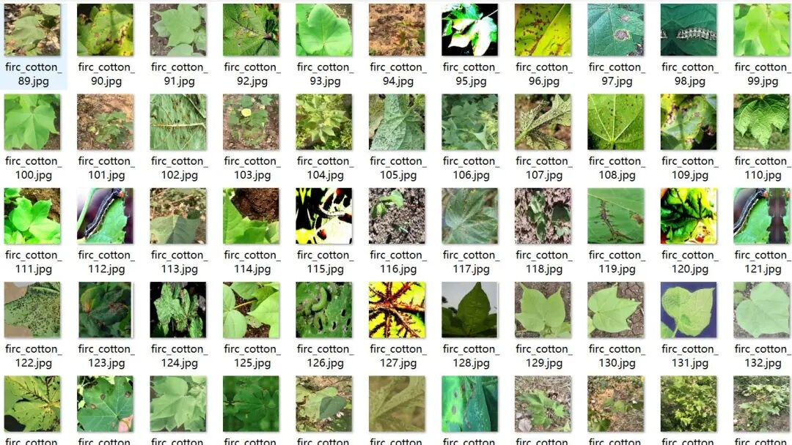
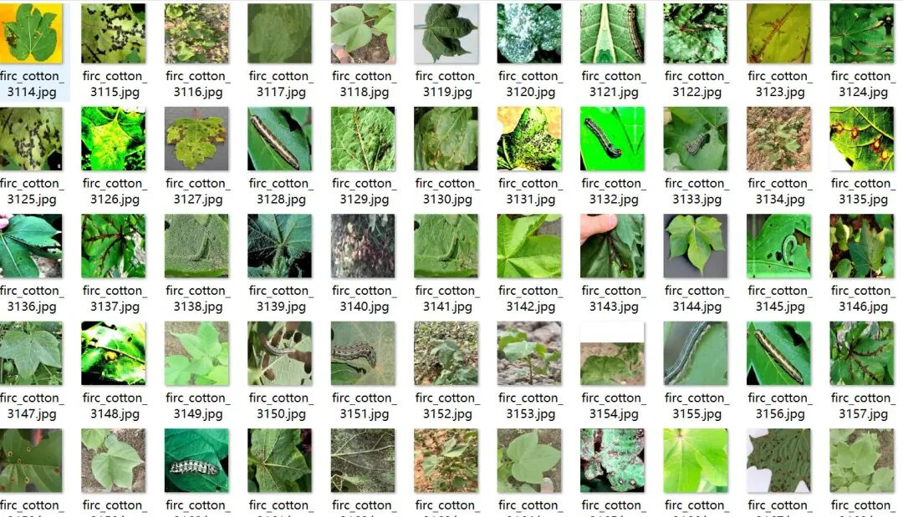
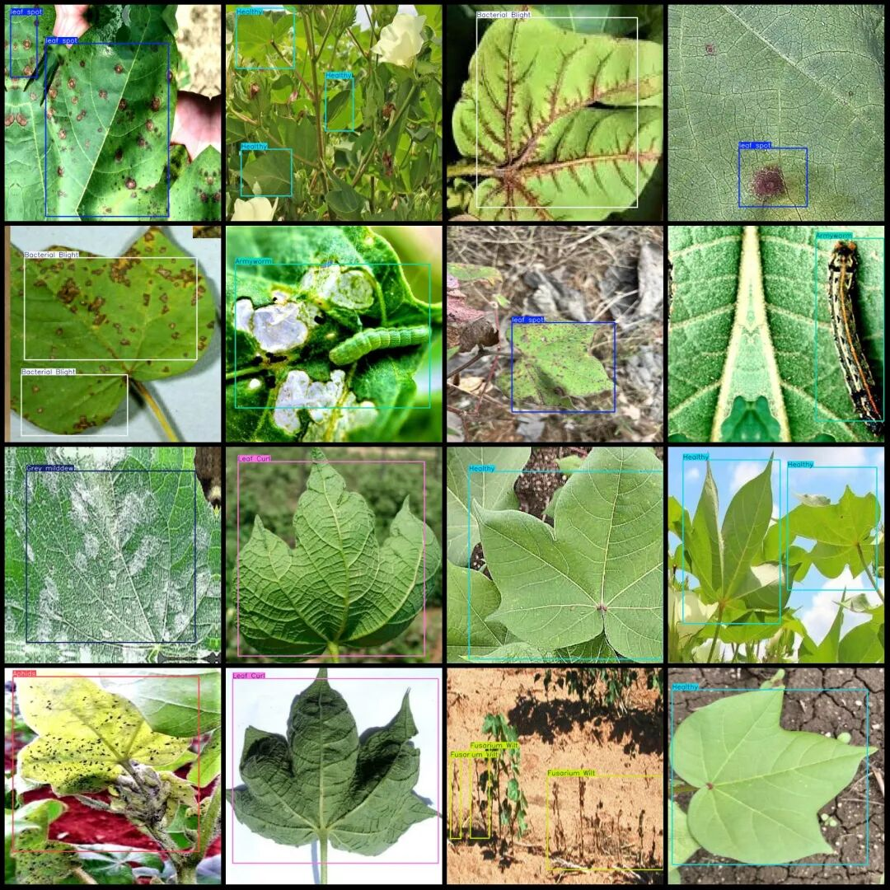

# Cotton Leaf Disease and Pest Detection Dataset VOC+YOLO format with 5400 images in 8 categories

Dataset format: Pascal VOC format + YOLO format (txt file without split path, only containing jpg images and corresponding VOC format xml files and yolo format txt files)

Number of images (number of jpg files): 5400

Number of annotations (number of xml files): 5400

Number of annotations (number of txt files): 5400

Annotation Category Count: 8

Label category names (note that the order of categories in the YOLO format does not correspond to this, but is based on the labels folder's classes.txt): ["Aphids", "Armyworm", "Bacterial Blight", "Fusarium Wilt", "Grey mildew", "Healthy", "Leaf Curl", "leaf spot"]

Number of boxes labeled in each category:

Aphids - Frames = 845

Armyworm - Number of frames = 802

Bacterial Blight - Frames = 1250

Fusarium Wilt - Fusarium Wilt frame count = 913

Grey mildew - Frames = 244

Health-Healthy Frames = 3170

Leaf Curl - Frame Count = 410

Leaf spot - Frame count = 1551

Total frame count: 9185

Using labelImg:

Image resolution: 640x640

Annotation rules: Draw a rectangle around the category.

Important Notice: No

Special : This dataset does not guarantee the accuracy of the trained models or weight files.

Image Preview:

Annotation example:

## Payment

Here is a pay link on Stripe ( https://buy.stripe.com/3cs8yP7sY87d0vu9AB ). Please contact me lonlonago@foxmail.com after funding $89, and I will send you a complete data files , thank you!

